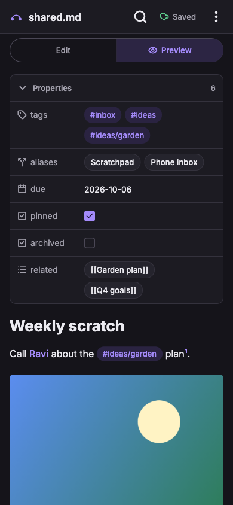
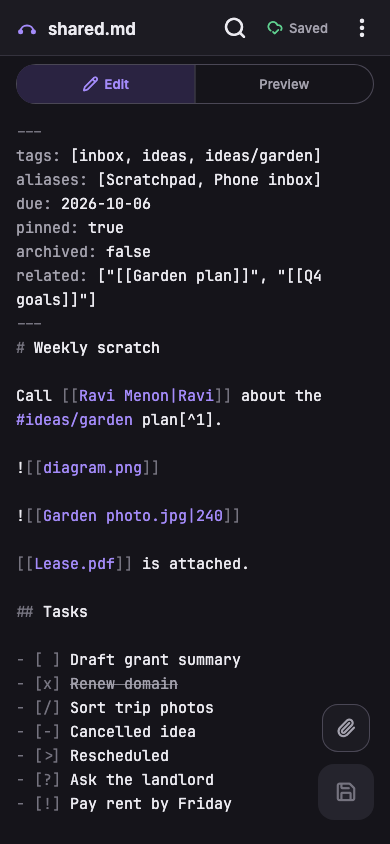
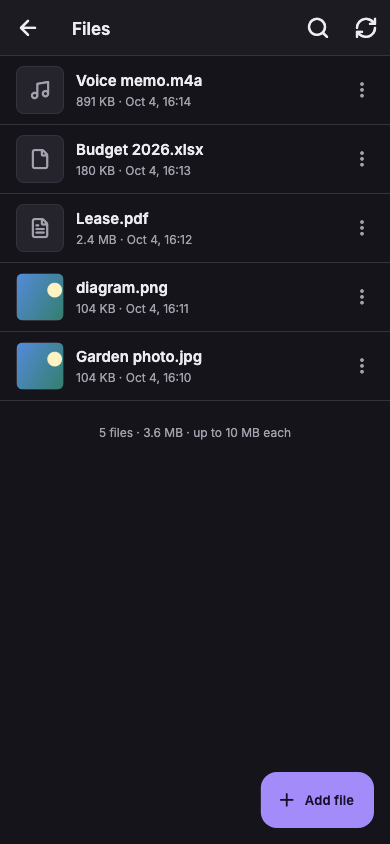
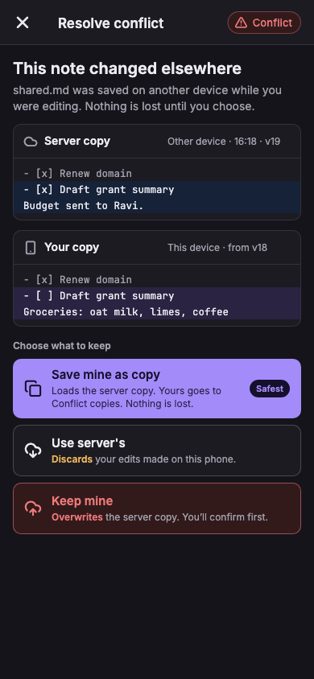

# VaultBridge

**One Obsidian note, everywhere, without syncing your whole vault.**

[](https://github.com/Vanshpanchal/obsidian-shared-note-sync/actions/workflows/ci.yml)
[](https://github.com/Vanshpanchal/obsidian-shared-note-sync/releases/latest)
[](https://github.com/Vanshpanchal/obsidian-shared-note-sync/blob/main/LICENSE)

Repository: <https://github.com/Vanshpanchal/obsidian-shared-note-sync>

VaultBridge keeps a single note (`Shared/shared.md`) and its attachments in sync between
your Obsidian vault and your phone. Use it as a scratchpad: jot something down on the
phone, find it in Obsidian a moment later (and the other way round), including the pictures,
PDFs and other files you attach.

You run the backend yourself, on your own [Appwrite](https://appwrite.io) project, so
your notes never touch anyone else's server.

<table>
  <tr>
    <td></td>
    <td></td>
    <td></td>
    <td></td>
  </tr>
  <tr>
    <td align="center">Preview</td>
    <td align="center">Edit</td>
    <td align="center">Files</td>
    <td align="center">Conflict</td>
  </tr>
</table>

## Contents

- [How it works](#how-it-works)
- [Two ways to use it](#two-ways-to-use-it)
- [Requirements](#requirements)
- [1. Deploy the backend](#1-deploy-the-backend)
- [2A. Use it in Obsidian (desktop and mobile)](#2a-use-it-in-obsidian-desktop-and-mobile)
- [2B. Use the Flutter app](#2b-use-the-flutter-app)
- [Everyday use](#everyday-use)
- [Attachments](#attachments)
- [What the app renders](#what-the-app-renders)
- [Troubleshooting](#troubleshooting)
- [API reference](#api-reference)
- [Security](#security)
- [Development](#development)
- [License](#license)

## How it works

```
 Obsidian (desktop + mobile)                Flutter app (iOS / Android / macOS)
 Shared/shared.md + Shared/assets/          editor, preview, files, search, PDF export
        │                                              │
        │  "Shared.md Sync" plugin                     │
        └─────────────────┐              ┌─────────────┘
                          ▼              ▼
              Appwrite Function  `shared-api`    <- you deploy this
              GET/POST /shared    GET /assets    GET/POST/DELETE /assets/file
                          │                │
                          ▼                ▼
              Appwrite database row    Appwrite storage bucket
              (the note + version)     (attachments)
```

- **One source of truth.** The note is a single database row with a `version`. Every save
  says which version it was based on.
- **Nothing is lost.** If someone saved in between, the server answers `409` and you pick
  what to keep (yours, the server's, or save yours as a copy). Nothing is overwritten silently.
- **Offline-friendly.** Edits are kept on the device and sent when you are back online.

## Two ways to use it

Both need the backend from step 1. After that, pick the way that suits you, or use both.

| | **A. Obsidian only** | **B. Flutter app** |
|---|---|---|
| Where you write | Obsidian on desktop **and Obsidian Mobile** | The VaultBridge app on your phone, Obsidian on desktop |
| What you install | The **Shared.md Sync** plugin on each device | The app on the phone, the plugin on the desktop |
| Best for | You already live in Obsidian and just want the note on your phone | A fast, dedicated phone editor with search, files and PDF export |
| Steps | [1](#1-deploy-the-backend) then [2A](#2a-use-it-in-obsidian-desktop-and-mobile) | [1](#1-deploy-the-backend), [2B](#2b-use-the-flutter-app), and 2A on the desktop |

## Requirements

- An **Appwrite** project, either [Appwrite Cloud](https://cloud.appwrite.io) (the free plan
  is enough) or a self-hosted instance. Appwrite **1.8 or newer** (this project uses the
  `TablesDB` API).
- **Node.js 22+** on your computer, once, to create the database.
- For way A: **Obsidian 1.11.4+** (the plugin stores the API key in Obsidian's secret storage).
- For way B: **Flutter 3.44+ / Dart 3.12+**, plus Xcode (iOS/macOS) or the Android SDK.

---

## 1. Deploy the backend

Everything here happens once. It creates a database, a storage bucket and a function in
**your** Appwrite project.

### 1.1 Create the project and two keys

1. In the [Appwrite Console](https://cloud.appwrite.io) create a **project**. Note its
   **Project ID** (Settings) and your **API endpoint**, which looks like
   `https://<region>.cloud.appwrite.io/v1` (for example `https://fra.cloud.appwrite.io/v1`).
   Self-hosting: `https://<your-domain>/v1`.
2. Make a **setup API key** (Overview → Integrations → API keys → Create). Give it these scopes,
   read and write for each: `databases`, `tables`, `columns`, `rows`, `buckets`, `files`.
   You only need it for the next step, and you can delete it afterwards.
3. Generate the **shared secret** your clients will use to talk to the function:

   ```sh
   openssl rand -base64 32
   ```

### 1.2 Create the database and bucket

```sh
git clone https://github.com/Vanshpanchal/obsidian-shared-note-sync.git
cd obsidian-shared-note-sync

cp backend/.env.example backend/.env
# edit backend/.env: APPWRITE_ENDPOINT, APPWRITE_PROJECT_ID, APPWRITE_API_KEY (the setup key)
# and SHARED_API_KEY (the secret from 1.1)

cd backend/functions/shared-api && npm install && cd ../../..
node backend/scripts/setup-db.mjs
```

The script is safe to re-run. It creates:

- database `brain`, table `shared` (columns `content`, `version`, `updatedAt`, `deviceId`)
  and the row `shared`, with **no client permissions**, so only server keys can reach it;
- storage bucket `assets` (10 MB per file by default), also with no client permissions.

### 1.3 Deploy the function

In the Console go to **Functions → Create function**.

**Settings**

| Setting | Value |
|---|---|
| Runtime | Node.js 22 (or newer) |
| Entrypoint | `src/main.js` |
| Build commands | `npm install` |
| Execute access | **Any** (the `x-api-key` header protects it) |

**Code.** Use either:

- **Git:** connect your fork of this repository, root directory `backend/functions/shared-api`; or
- **Upload:** run `./backend/scripts/package-function.sh`, then upload
  `backend/shared-api.tar.gz` under *Manual deployment*.

**Scopes** (function → Settings → Scopes): `rows.read`, `rows.write`, `files.read`, `files.write`.
With these the function uses the short-lived key Appwrite gives each execution, so you do not
have to create or store another API key.

**Environment variables** (function → Settings → Variables)

| Variable | Value |
|---|---|
| `SHARED_API_KEY` | the secret from 1.1 (mark it **secret**) |
| `DATABASE_ID` | `brain` |
| `COLLECTION_ID` | `shared` (this holds the table ID) |
| `BUCKET_ID` | `assets` |
| `ASSET_MAX_BYTES` | optional, default `10485760` (10 MB) |

Deploy, then open the **Domains** tab and copy the function's domain. This is your
**endpoint URL**, for example `https://65f0abc.fra.appwrite.run`. Use it without a trailing
`/shared`.

> Not using the scopes above? You can instead add `APPWRITE_API_KEY` as a function variable
> (a key with `rows` and `files` read/write only). The function prefers it when present.

### 1.4 Check it works

```sh
curl -H "x-api-key: <SHARED_API_KEY>" https://<function-domain>/shared
# {"content":"","version":0,"updatedAt":"..."}

curl -H "x-api-key: wrong" https://<function-domain>/shared
# {"error":"unauthorized"}  (HTTP 401)
```

For the full live test (save, conflict, wrong key, size limit, attachments), put
`SHARED_URL` and `SHARED_API_KEY` in `backend/.env` and run:

```sh
./backend/scripts/acceptance.sh        # needs jq
```

Keep these two values handy: the **endpoint URL** and the **shared secret**.

---

## 2A. Use it in Obsidian (desktop and mobile)

The plugin **Shared.md Sync** keeps `Shared/shared.md` and the `Shared/assets` folder equal to
your backend. Install it on every device where you use Obsidian.

### Install

**Option 1: BRAT (easiest, works on mobile)**

1. In Obsidian: Settings → Community plugins → turn off Restricted mode → Browse → install
   and enable **BRAT**.
2. BRAT settings → **Add beta plugin** → enter `Vanshpanchal/obsidian-shared-note-sync`.
3. Enable **Shared.md Sync** in Community plugins.

This needs a GitHub release that contains `main.js` and `manifest.json`. Pushing a tag equal
to the version in `obsidian-plugin/manifest.json` creates one automatically (see
[Development](#development)).

**Option 2: Manual**

1. Get `main.js` and `manifest.json`: download them from the
   [Releases page](https://github.com/Vanshpanchal/obsidian-shared-note-sync/releases/latest), or build them:

   ```sh
   cd obsidian-plugin && npm install && npm run build
   ```

2. Copy the two files into `<your vault>/.obsidian/plugins/shared-md-sync/`.
3. Obsidian → Settings → Community plugins → turn off Restricted mode → enable
   **Shared.md Sync**.

**Getting the plugin onto your phone (Option 2).** Obsidian Mobile cannot install a plugin
from a loose file, so the plugin folder has to arrive with your vault:

| How your vault reaches the phone | What to do |
|---|---|
| Obsidian Sync | Settings → Sync → turn on **Installed community plugins** on both devices |
| iCloud Drive | Nothing extra. iCloud syncs `.obsidian` too. (The iOS Files app hides it, so do not copy by hand.) |
| Git (Obsidian Git) | Commit and pull `.obsidian/plugins/shared-md-sync` (**but not** `data.json`, see below) |
| Android, local vault | Copy the folder over USB, or with a file manager that shows hidden files |

Or skip all of this and use BRAT on the phone.

> **Do not sync `data.json`.** It holds each device's own sync state. If you use git or another
> tool for your vault, ignore it:
> `.obsidian/plugins/shared-md-sync/data.json`.
> Also ignore `Shared/shared.md` in git, so git and the plugin do not both sync the note.

### Configure (on each device)

Settings → **Shared.md Sync**:

| Setting | Value |
|---|---|
| Endpoint URL | your function domain, no trailing `/shared` |
| API key | the shared secret. It is stored in the device's secret storage, so enter it on **every** device |
| Target path | `Shared/shared.md` (default) |
| Attachments folder | `Shared/assets` (default) |

Run the command **Pull shared.md**. On first use the note appears (empty at first). Edit it, and
a few seconds later the other devices have it.

### What it does

- Pulls on startup, when the note is opened, and every few minutes (configurable).
- Pushes 3 seconds after you edit.
- Syncs the attachments folder both ways. Files the note embeds that Obsidian saved somewhere
  else (its own attachment setting) are moved into the attachments folder so they sync.
- On a conflict, writes the server copy to `Shared/shared.conflict.md` and pauses. Merge into
  `shared.md`, then run **Resolve conflict: keep my shared.md (push it)** or
  **Resolve conflict: use server copy**.

Commands: *Pull shared.md*, *Push shared.md*, *Sync attachments now*, and the two conflict commands.

---

## 2B. Use the Flutter app

The app is an editor and an Obsidian-style preview for the same note, with a Files tab for
attachments, find-in-note, and PDF export. It runs on iOS, Android and macOS.

### Build and install

```sh
cd app
flutter pub get
flutter run                       # with a phone connected, or a simulator
```

To install a standalone build on a device:

| Platform | Command | Then |
|---|---|---|
| Android | `flutter build apk --release` | Install `build/app/outputs/flutter-apk/app-release.apk` (allow installs from your file manager) |
| iOS | `flutter build ios --release` | Open `ios/Runner.xcworkspace` in Xcode, pick your team, run on your device. A free Apple ID works but the app expires after 7 days. TestFlight needs a paid account |
| macOS | `flutter build macos --release` | Copy `build/macos/Build/Products/Release/vault_bridge.app` to Applications |

Before you ship it to others, change the application IDs (`dev.vansh.vault_bridge` on Android,
`dev.vansh.vaultBridge` on iOS and macOS) to your own.

### Connect it to your backend

On first launch the app asks for:

- **Endpoint URL**: your function domain (no trailing `/shared`)
- **API key**: the shared secret

Tap **Test connection**, then **Connect**. The key goes into the iOS Keychain or Android Keystore.
Later, change them under ⋮ → Settings.

### Use the app with Obsidian

Install the plugin ([2A](#2a-use-it-in-obsidian-desktop-and-mobile)) on your desktop so that
the note and the attachments appear in your vault.

---

## Everyday use

**Status chip** (top right)

| Chip | Meaning |
|---|---|
| Saved | This device matches the server |
| Unsaved / Saving | An edit is waiting to be sent, or is being sent |
| Offline (pending) | No network. The edit is kept and retried on reconnect, on resume, or every 30 s |
| Conflict | The note changed elsewhere while you had unsaved edits. Tap to resolve |
| Error / Not set up | Wrong key, server error or missing settings. Tap for details |

**In the app**

- The **Edit** tab is a Markdown editor with Obsidian syntax coloured as you type. It saves
  2 s after you stop typing, when you tap 💾, and when the app goes to the background.
- The **Preview** tab renders the note like Obsidian's reading view.
- The 🔍 button searches the note in either tab: matches are highlighted, with a counter and
  up/down arrows to jump between them. **Files → 🔍** filters your attachments.
- **⋮ → Export as PDF** renders the preview, pictures included, to a PDF and opens the share sheet.
- Tapping outside a search box drops its focus and closes the keyboard.

**When there is a conflict**, the app shows the server copy next to yours:

- **Save mine as copy** loads the server's version and keeps yours under ⋮ → Conflict copies.
  Nothing is lost. This is the safe choice.
- **Use server's** discards the edits made on this device.
- **Keep mine** overwrites the server (it asks you to confirm).

## Attachments

Attach a photo, a file or a picture from the camera with the 📎 button (Edit tab). The app
uploads it and inserts a link:

- images become `![[photo.png]]` and show in the preview and in Obsidian;
- other files become `[[manual.pdf]]` and open from the preview.

In Obsidian these are plain wikilinks to files in `Shared/assets`, so they render normally.
Files you attach in Obsidian (paste, drag, "Attach file") are moved into `Shared/assets` by the
plugin and uploaded, so the app shows them too. The app also understands the
`` link style Obsidian uses when wikilinks are off.

Limits and rules:

- 10 MB per file by default (`ASSET_MAX_BYTES`).
- Names cannot contain `/ \ : * ? " < > | # ^ [ ]`, and cannot start or end with a dot. The app
  fixes names for you.
- Deleting a file in the app, in Obsidian or in the bucket deletes it everywhere.
- Obsidian on desktop cannot display HEIC photos. If you attach a `.heic` file, convert it to
  JPEG first, or it will not render there.

## What the app renders

The preview is a custom renderer built for Obsidian's syntax:

| Obsidian feature | In the app |
|---|---|
| Properties (YAML frontmatter) | A panel with tag pills, list chips and checkboxes |
| Callouts `> [!note]`, all types, foldable and nested | Coloured boxes with icons |
| `#tags`, `[[wikilinks]]`, `[[Note#Heading]]`, `[[Note\|alias]]` | Pills and links. Wikilinks to attachments open them; others open the note in Obsidian |
| `![[image.png]]`, `![[file.pdf]]` | The picture itself, or a file chip |
| `==highlight==`, `%%comments%%`, `^block-ids` | Highlight shown, comments and block IDs hidden |
| Tasks `[ ]` `[x]` `[/]` `[-]` `[>]` `[?]` `[!]` and more | Checkboxes and status icons |
| Math `$…$`, `$$…$$` | Rendered LaTeX |
| Mermaid diagrams | Drawn in the app, with a full-screen zoomable view |
| Footnotes, tables, code blocks (with copy button), `<details>`, `<kbd>`, `<sub>`, `<sup>` | Styled like Obsidian |
| Dataview, Tasks and other plugin blocks | Shown as source, labelled "renders in Obsidian" |

## Troubleshooting

| Symptom | Fix |
|---|---|
| `401 unauthorized` | The API key does not match the function's `SHARED_API_KEY`. Re-enter it on that device |
| `{"error":"not_found"}` | The endpoint URL has a path in it. Use the bare domain, without `/shared` |
| Attachments fail but the note syncs | The bucket or the file scopes are missing. Run `setup-db.mjs` (it creates the bucket), set `BUCKET_ID` on the function, add the `files.read` / `files.write` scopes and redeploy |
| Function returns 500 | Check the function's **Executions → Logs**. Usually a missing scope or a wrong `DATABASE_ID`, `COLLECTION_ID` or `BUCKET_ID` |
| Setup script says "Missing env var" | Fill in `backend/.env` (see `.env.example`) |
| Pictures from the app do not show in Obsidian | Run **Sync attachments now** in Obsidian. Files uploaded by an older version with `+` in their name should be re-attached |
| Pictures from Obsidian do not show in the app | Make sure *Move embedded files into the attachments folder* is on, then run **Sync attachments now**. Names containing `# ^ [ ] \|` cannot sync |
| Plugin is missing on the phone | Mobile gets plugins through your vault sync or BRAT. See [Install](#install) |
| API key is empty on a new device | Intentional: the key lives in each device's secret storage, so enter it once per device |
| "File is too large" | The default limit is 10 MB. Raise `ASSET_MAX_BYTES` on the function (and in `backend/.env` before running setup) |
| First request after a while is slow | Appwrite Functions cold-start. Retry |

## API reference

All requests need the header `x-api-key: <SHARED_API_KEY>` (checked in constant time). Without
it you get `401`.

**Note**

| Call | Result |
|---|---|
| `GET /shared` | `200 { content, version, updatedAt }` (creates an empty row, v0, if missing) |
| `POST /shared` with `{ content, baseVersion, deviceId }` | `200 { version, updatedAt }`, or `409 { content, version, updatedAt }` if `baseVersion` is stale |
| `POST /shared?force=true` | Overwrite even if stale. Only after the user picks "Keep mine" |

The server owns `version` and bumps it by 1 on each save, with an atomic increment capped at
`baseVersion + 1`, so two simultaneous saves cannot both win. Content is at most 1 MB of UTF-8
(`413` above that). `\r\n` is stored as `\n`.

**Attachments**

| Call | Result |
|---|---|
| `GET /assets` | `200 { files: [{ name, size, mimeType, createdAt, updatedAt }], maxBytes }` |
| `GET /assets/file?name=<name>` | The file's bytes (with an `x-asset-size` header), or `404` |
| `POST /assets/file?name=<name>` (raw bytes) | `201` created. `409` if the name exists (add `&overwrite=true` to replace), `413` if too large, `400` for an invalid name |
| `DELETE /assets/file?name=<name>` | `200 { deleted }`, or `404` |

File IDs are derived from the lower-cased name, so `A.png` and `a.png` are the same file
(vaults on macOS and Windows are case-insensitive). Send names percent-encoded (`%20` for a space).

## Security

- The shared secret is meant for **personal use**. Treat it like a password. Never commit it:
  `backend/.env` is git-ignored, the app keeps it in the Keychain/Keystore, and the plugin keeps
  it in Obsidian's secret storage.
- The database table and the bucket have **no client permissions**. Only the function (using its
  own server-side key) can read or write them.
- Mark `SHARED_API_KEY` as **secret** on the function, delete the setup API key after step 1.2,
  and give the function only the scopes listed in 1.3.
- The function never logs note content or keys.
- To let other people use your deployment, do not hand out the shared secret. Switch to Appwrite
  Auth (user JWT, function execute permission set to `users`) instead.

## Development

```
app/                    Flutter app (lib/data, lib/markdown, lib/export, lib/ui)
backend/                Appwrite function, setup script, acceptance tests
obsidian-plugin/        Obsidian plugin (TypeScript, bundled to main.js)
docs/screenshots/       Images used in this README
.github/workflows/      CI and the plugin release job
```

```sh
# backend
cd backend/functions/shared-api && npm ci && npm test

# plugin
cd obsidian-plugin && npm ci && npm run build && npm test

# app
cd app && flutter pub get && flutter analyze && flutter test
```

CI runs all three on every push and pull request.

**Releasing the plugin.** Bump `version` in `obsidian-plugin/manifest.json` and
`obsidian-plugin/package.json`, add the version to `obsidian-plugin/versions.json`, then:

```sh
git tag 1.2.0 && git push origin 1.2.0
```

The *Release plugin* workflow builds the plugin and attaches `main.js` and `manifest.json` to a
GitHub release. That is what BRAT and manual downloads use.

**Regenerating the screenshots**

```sh
cd app
CAPTURE_DIR=/tmp/shots flutter test tool/capture_screens_test.dart
```

## Contributing and support

Bug reports and ideas are welcome on the [issue tracker](https://github.com/Vanshpanchal/obsidian-shared-note-sync/issues).

## License

[MIT](LICENSE)
