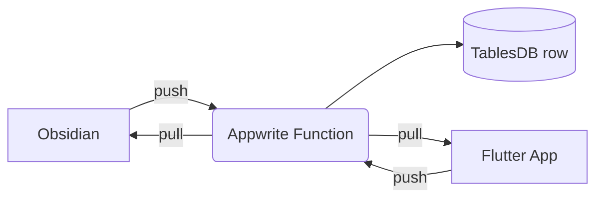
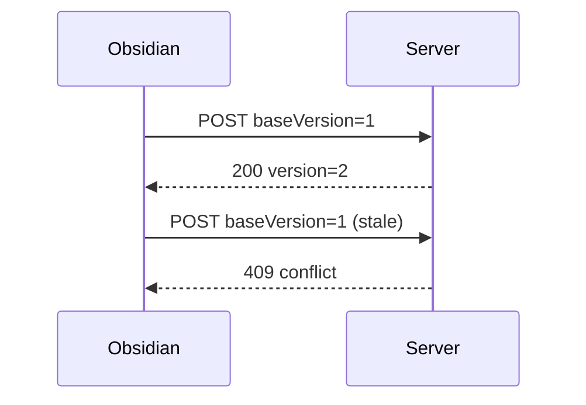

# Obsidian Syntax Reference

A single note showing the Obsidian syntax used most often. It also works as a sync test between Obsidian and the VaultBridge app.

> [!info] About this note
> This note is synced by **Shared.md Sync**. The Flutter app's preview shows standard markdown, so Obsidian-only syntax such as `[[links]]`, callouts and `%%comments%%` appears there as plain text.

---

## 1. Headings

# H1 Heading
## H2 Heading
### H3 Heading
#### H4 Heading
##### H5 Heading
###### H6 Heading

---

## 2. Text Formatting

| Style | Syntax | Result |
|---|---|---|
| Bold | `**bold**` | **bold** |
| Italic | `*italic*` | *italic* |
| Bold + italic | `***both***` | ***both*** |
| Strikethrough | `~~strike~~` | ~~strike~~ |
| Highlight | `==highlight==` | ==highlight== |
| Inline code | `` `code` `` | `code` |
| Subscript | `H<sub>2</sub>O` | H<sub>2</sub>O |
| Superscript | `x<sup>2</sup>` | x<sup>2</sup> |
| Keyboard | `<kbd>Cmd</kbd>` | <kbd>Cmd</kbd> + <kbd>P</kbd> |

Comment (hidden in reading view): %%This is a hidden comment%%

%%
A multi-line comment.
It is only visible in editing view.
%%

Escape special characters: \*not italic\*, \#not-a-tag, \[\[not a link\]\]

Line break: end a line with two spaces  
or use `<br>`.<br>Like this.

---

## 3. Tags

Inline tags: #reference #obsidian #idea

Nested tags: #project/vaultbridge #status/in-progress #area/learning

Tags in the frontmatter (top of the note) are listed under `tags:`.

---

## 4. Internal Links (Wikilinks)

- Link to a note: [[Home]]
- Link with a display alias: [[Home|Go to Home]]
- Link to a heading: [[Home#Projects]]
- Link to a heading in this note: [[#5. Embeds]]
- Link to a block: [[Home#^important-block]]
- Markdown-style internal link: [Home](Home.md)

This paragraph has a block ID, so other notes can link to it directly. ^important-block

---

## 5. Embeds

- Embed a whole note: `![[Home]]`
- Embed a heading section: `![[Home#Projects]]`
- Embed a block: `![[Home#^important-block]]`
- Embed an image: `![[image.png]]`
- Image with width: `![[image.png|300]]`
- Embed a PDF page: `![[document.pdf#page=3]]`
- Embed audio/video: `![[recording.mp3]]`

External image:


---

## 6. External Links

- Markdown link: [Obsidian Help](https://help.obsidian.md)
- Autolink: <https://obsidian.md>
- Bare URL: https://appwrite.io
- Link to another vault note via URI: [Open note](obsidian://open?vault=MyVault&file=Home)

---

## 7. Lists

### Unordered
- Item one
- Item two
  - Nested item
    - Deeper nested item
- Item three

### Ordered
1. First
2. Second
   1. Sub-step A
   2. Sub-step B
3. Third

### Mixed
1. Plan
   - Research
   - Outline
2. Build
   - [ ] Backend
   - [x] Database

---

## 8. Tasks

- [ ] Open task
- [x] Completed task
- [ ] Task with a due date 📅 2026-10-10
- [ ] High-priority task ⏫ #status/todo
- [ ] Task linking a note: review [[Home]]
  - [ ] Nested subtask
  - [x] Done subtask

Alternative statuses (shown by many themes):

- [/] In progress
- [-] Cancelled
- [>] Deferred
- [?] Question
- [!] Important

---

## 9. Blockquotes

> A simple blockquote.
>
> > A nested blockquote.
>
> — Author Name

---

## 10. Callouts

> [!note]
> The default callout. Use it for general notes.

> [!abstract] Summary
> Also available as `[!summary]` and `[!tldr]`.

> [!info] Information
> Useful context or background.

> [!todo] To do
> - [ ] Finish the sync setup
> - [ ] Test on mobile

> [!tip] Tip
> Also `[!hint]` and `[!important]`.

> [!success] Success
> Also `[!check]` and `[!done]`.

> [!question] Question
> Also `[!help]` and `[!faq]`.

> [!warning] Warning
> Also `[!caution]` and `[!attention]`.

> [!failure] Failure
> Also `[!fail]` and `[!missing]`.

> [!danger] Danger
> Also `[!error]`.

> [!bug] Bug
> Describe the bug here.

> [!example] Example
> Show an example here.

> [!quote] Quote
> "The best way to predict the future is to invent it." — Alan Kay

> [!tip]+ Foldable callout (open by default)
> Click the title to collapse it.

> [!warning]- Foldable callout (closed by default)
> This content is hidden until expanded.

> [!note] Nested callouts
> Outer callout content.
> > [!tip] Inner callout
> > Callouts can be nested.

---

## 11. Tables

| Left aligned | Centered | Right aligned |
|:---|:---:|---:|
| Apple | 🍎 | 1.20 |
| Banana | 🍌 | 0.50 |
| Mango | 🥭 | 2.00 |

Table with links and formatting:

| Note | Status | Priority |
|---|---|---|
| [[Home]] | ==Active== | **High** |
| [[Projects]] | ~~Paused~~ | *Low* |

---

## 12. Code

Inline: use `const x = 1;` in a sentence.

```javascript
// JavaScript
function greet(name) {
  return `Hello, ${name}!`;
}
```

```dart
// Dart / Flutter
void main() {
  print('Hello from VaultBridge');
}
```

```bash
# Shell
flutter run
npm run build
```

```json
{
  "content": "# shared.md",
  "baseVersion": 1,
  "deviceId": "obsidian"
}
```

---

## 13. Math (LaTeX)

Inline math: $E = mc^2$ and $a^2 + b^2 = c^2$

Block math:

$$
\int_{0}^{\infty} e^{-x^2}\,dx = \frac{\sqrt{\pi}}{2}
$$

$$
\begin{bmatrix} 1 & 2 \\ 3 & 4 \end{bmatrix}
$$

---

## 14. Diagrams (Mermaid)





---

## 15. Footnotes

Here is a sentence with a footnote.[^1] And another one.[^note]

An inline footnote.^[This footnote is written inline.]

[^1]: The first footnote.
[^note]: A named footnote with **formatting**.

---

## 16. Search Query Embed

```query
tag:#project
```

Dataview (requires the Dataview plugin):

```dataview
TABLE status, priority
FROM #project
SORT priority ASC
```

---

## 17. HTML

<details>
<summary>Click to expand</summary>

Hidden content inside a `<details>` block.

</details>

<mark>Highlighted with HTML</mark> and <u>underlined</u> text.

<span style="color: tomato">Colored text</span>

---

## 18. Horizontal Rules

Three ways to draw one:

***

___

---

## 19. Unicode and Emoji (sync test)

- Gujarati: નમસ્તે, કેમ છો?
- Hindi: नमस्ते, आप कैसे हैं?
- Emoji: 🚀 ✅ 📝 🔄 🙏
- Symbols: → ← ✓ ✗ ∞ ≈ ≠ €

---

## 20. Quick Keyboard Shortcuts (macOS)

| Action | Shortcut |
|---|---|
| Command palette | <kbd>Cmd</kbd> + <kbd>P</kbd> |
| Quick switcher | <kbd>Cmd</kbd> + <kbd>O</kbd> |
| Toggle edit/preview | <kbd>Cmd</kbd> + <kbd>E</kbd> |
| Search in vault | <kbd>Cmd</kbd> + <kbd>Shift</kbd> + <kbd>F</kbd> |
| Bold / Italic | <kbd>Cmd</kbd> + <kbd>B</kbd> / <kbd>Cmd</kbd> + <kbd>I</kbd> |
| Toggle checkbox | <kbd>Cmd</kbd> + <kbd>L</kbd> |
| Insert link | <kbd>Cmd</kbd> + <kbd>K</kbd> |
